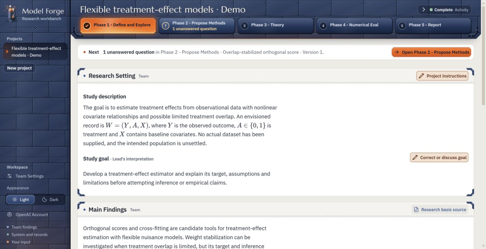
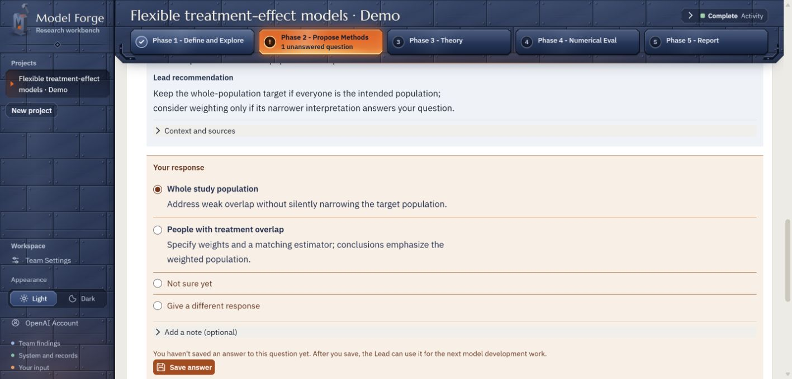

# Anonymous research workbench

This local workbench supports developing statistical and machine learning models and algorithms with an AI research team. Start from a problem, compare approaches, examine theory and numerical evidence, and build a **technical report** with mathematics, citations, and links to supporting work.

**You direct the research.** The team invites your input on critical decisions affecting the scientific goal, model interpretation, statistical claims, data applicability, or meaningful resource tradeoffs. Each decision explains its consequences. Discuss the question, ask for the Lead's advice, and save an editable answer for future work. The Lead handles routine choices; you choose which phase to run next.



*Earlier 0.9.3 interface with a synthetic demonstration project. The current source uses a brushed silver frame. The example content illustrates the interface and is not output from a live model run.*

## Install and use

Use shared **Node.js 22+ with npm** and **Python 3.11+** installations. Run the following commands from the repository root, using `python` for your selected shared Python executable. Install packages user-wide or machine-wide; do not create a project-local environment.

Install the backend and development dependencies:

```sh
python -m pip install --user "setuptools>=68" wheel
python -m pip install --user --no-build-isolation ".[dev]"
```

Install the frontend dependencies globally, then build the interface:

```sh
npm install --global react@18.3.1 react-dom@18.3.1 katex@0.18.7 vite@5.4.11 @vitejs/plugin-react@4.3.4 @fontsource-variable/ibm-plex-sans@5.3.0 @fontsource/ibm-plex-mono@5.3.0 @fontsource/marcellus@5.3.0
node web/scripts/vite.mjs build
```

If the build cannot find the shared frontend packages, set `MF_SHARED_NODE_MODULES` to the output of `npm root --global` before building. In PowerShell, use `$env:MF_SHARED_NODE_MODULES = npm root --global`; in a POSIX shell, use `export MF_SHARED_NODE_MODULES="$(npm root --global)"`.

Start the app:

```sh
python -B scripts/run_from_source.py
```

The app opens at **[http://127.0.0.1:8766](http://127.0.0.1:8766)**. Keep the terminal open while using it. The Codex desktop app is optional.

1. **Create a project.** Describe your problem, data collection, goal, and constraints. Data are optional.
2. **Connect the team.** In **Workspace → OpenAI Account**, sign in and connect the account to the research team, or configure an API provider in **Workspace → Team Settings**. Select available models and reasoning efforts, then run **Test saved settings** for each member. Tests may consume provider tokens; configured credentials alone do not establish a working connection.
3. **Start Phase 1.** Read the interpreted problem and findings, correct the team's understanding, and discuss consequential choices. Saving an answer or instruction does not start a research run. Work already underway keeps its recorded inputs.

For a first project, try: “Develop a model to predict an outcome from baseline and repeated measurements. I do not have data ready yet. Compare feasible approaches and explain which assumptions need my input.”

On native Windows, complete the shared Codex runtime's one-time sandbox setup. Managed **Phase 4 numerical experiments require elevated Windows sandbox mode and completed setup**, plus shared scientific runtimes and packages accessible inside the sandbox. See [model access and runtime setup](docs/model-access.md) for sign-in, API providers, and experiment dependencies.

Projects and settings are saved separately from application files. Use `--data-root PATH` for another folder. The source launcher uses the Python executable that invokes it. See `--help` for all options.

Finish or cancel active research before stopping. Use the same data folder and port when checking or stopping a custom instance:

```sh
python -B scripts/run_from_source.py status
python -B scripts/run_from_source.py stop
```

For further setup and development guidance, see the [development guide](docs/development.md#source-checkout).

Windows package launch and browser onboarding have been checked locally. Native clean-profile macOS/Linux verification remains pending. Model-generated scientific claims and results require researcher review.

## Five research phases

Run the phases that serve your question, returning to earlier work when needed. Data are optional at the start; numerical work can use synthetic data or available real data.

| Phase | Purpose |
| --- | --- |
| **Phase 1 - Define and Explore** | Frame the problem and review the literature. |
| **Phase 2 - Propose Methods** | Formulate, compare, and select methods. |
| **Phase 3 - Theory** | Examine assumptions, claims, and mathematical arguments. |
| **Phase 4 - Numerical Eval** | Implement and evaluate methods on synthetic or available real data. |
| **Phase 5 - Report** | Read, discuss, revise, and export the technical report. |



*Choosing which population a treatment effect should describe. This illustrative selection has not been saved; the researcher can add a note or give a different response. The content is synthetic, not live model output.*

## Architecture and design

- **Specialized team.** A Research Lead, Theorist, Data Analyst, and Outside Reviewer work through a Codex bridge. Structured outputs feed the interface directly.
- **Researcher interaction.** Blue marks team findings, navy marks system controls, and orange marks researcher input. Questions support discussion, advice, and editable answers. Reports support section-level discussion and self-contained HTML export.
- **Traceable work.** Findings link to their method, theory, and experiment sources. Application updates preserve research history; each project retains its workflow catalog until explicitly updated.
- **Consistent scientific presentation.** A shared notation record carries mathematical definitions across phases. The Lead uses presentation guidance for summaries, notation, tables, figures, and consequential questions.
- **Local workspace.** React provides the interface and FastAPI manages runs and artifacts. Research is stored locally; model requests go to your configured account or provider.

See the [architecture guide](architecture/README.md) for component responsibilities, artifact flow, and UI specifications.

## Development

The [development guide](docs/development.md) covers source installation, local servers, focused tests, and package preparation. Use shared runtimes and packages, and a separate research folder for development.

```text
src/                    Backend, orchestration, storage, and Codex bridge
web/                    React interface and frontend checks
contracts/              Versioned team instructions, schemas, and examples
tests/                  Backend and package checks
architecture/           System design and interface specifications
```

Read [CONTRIBUTING](CONTRIBUTING.md) before changing workflow contracts or preparing a release. Application and workflow catalog versions are maintained separately.

Licensed under the MIT License.
